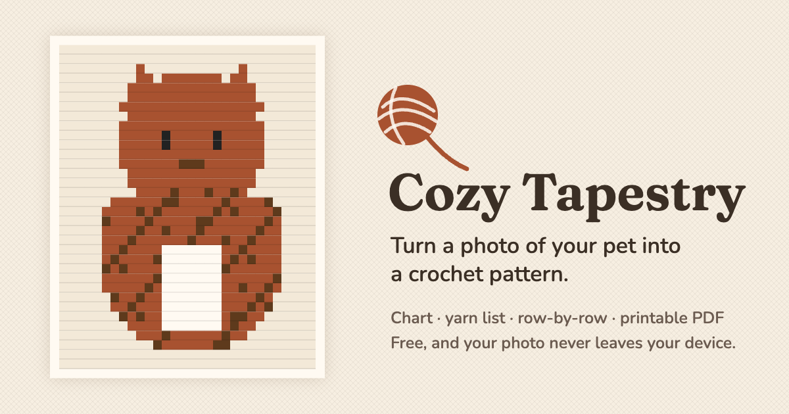

# Cozy Tapestry

Turn a photo of your pet into a crochet pattern — a thick blanket or a lighter decorative tapestry — with a stitch chart, a yarn shopping list, row-by-row instructions and a printable PDF.

**Try it: <https://maridream.github.io/cozy-tapestry/>**



## How it works

1. **Photo** — pick a photo of your pet (JPG or PNG; phone photos are turned upright).
2. **Cutout** — the app finds your pet and covers the background. Tidy it with the Keep / Erase brush if needed.
3. **Type & size** — Thick blanket (single crochet) or Decorative tapestry (Full color in double crochet, or Filet mesh), yarn weight, size from 1 × 1 ft to 5 × 8 ft.
4. **Design** — move and resize your pet anywhere, pick a patterned background (dots, stripes, zigzags, bones, paws, fish, feathers, scales, bubbles, tiger stripes and more — any direction, size and color) and add text in five fonts.
5. **Colors** — choose 2–8 colors, swap any of them for yarn you already have, and pick how much detail to keep.
6. **Pattern** — the finished pattern: preview, gauge, starting chain, yarn amounts and skeins, every row written out (`Row 12 (WS): 14 sc cream, 6 sc warm brown, 20 sc cream`), and a PDF with a numbered chart that also works printed in black and white.

US crochet terms throughout.

## Privacy

Everything happens in your browser. **Your photo is never uploaded** — there is no server. The only downloads are the app itself and the background-removal helper model, both served from this same site. Nothing is saved: when you close the tab, your photo and pattern are gone (download the PDF to keep it).

## Good to know

Sizes, gauge and yarn amounts are **estimates** based on average tension. Make a small gauge swatch before you start, and change hook size if it comes out bigger or smaller. Yarn amounts include about 10% extra.

Automatic cutouts work best with one pet, good light and a plain background. Busy patterned backgrounds, dim light or bars in front of the pet may need some touching up with the brush.

## Run it locally

You need [Node.js](https://nodejs.org) 20 or newer.

```bash
npm install
```

```bash
npm run dev
```

Then open <http://localhost:5173>. In VS Code you can also press **Cmd+Shift+B** (Run Build Task) to start the dev server.

| Command | What it does |
| --- | --- |
| `npm test` | Run the unit tests once |
| `npm run typecheck` | Check TypeScript types |
| `npm run build` | Type-check and build the site into `dist/` |
| `npm run preview` | Serve the built site locally |
| `node scripts/fetch-model.mjs` | Re-download the background-removal model into `public/models/imgly/` |

Every push to `main` is tested, built and published to GitHub Pages by [.github/workflows/deploy.yml](.github/workflows/deploy.yml).

## Project layout

```
docs/               Plan, architecture and one folder per build phase
src/types.ts        Shared data contracts
src/config/         Crochet numbers (gauge, yarn use, sizes) and wizard steps
src/app/            App shell, state, navigation, theme
src/steps/          One screen per wizard step
src/segmentation/   Background removal (runs in a Web Worker)
src/engine/         Photo → stitch chart → rows → yarn
src/export/         PDF export and shared pattern wording
tests/              Unit tests
```

## Credits

- Background removal: [`@imgly/background-removal`](https://github.com/imgly/background-removal-js) 1.7.0 by IMG.LY (AGPL-3.0), using the ISNet model (quantized, 44 MB) and [ONNX Runtime Web](https://github.com/microsoft/onnxruntime) 1.21.0 (MIT). The model files are served from this site (`public/models/imgly/`).
- PDF: [jsPDF](https://github.com/parallax/jsPDF) 4.2.1 (MIT).
- UI: [React](https://react.dev) (MIT), built with [Vite](https://vite.dev) (MIT).
- Fonts: Fraunces, Nunito, Pacifico and Bungee via [Fontsource](https://fontsource.org) (SIL Open Font License 1.1).

## License

[GNU AGPL v3.0 or later](LICENSE). You may use, change and share this code, but if you share or host a changed version you must publish its source under the same license. Third-party libraries and models keep their own licenses (see Credits).
